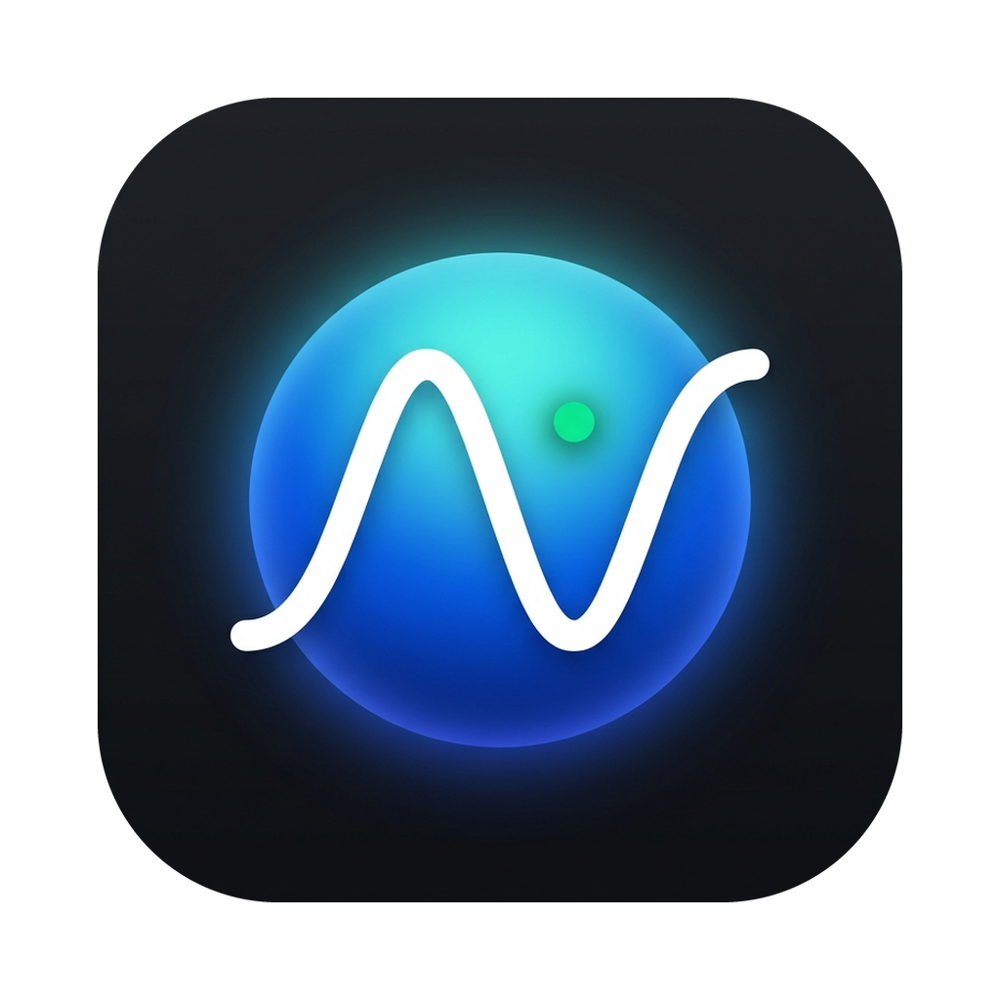
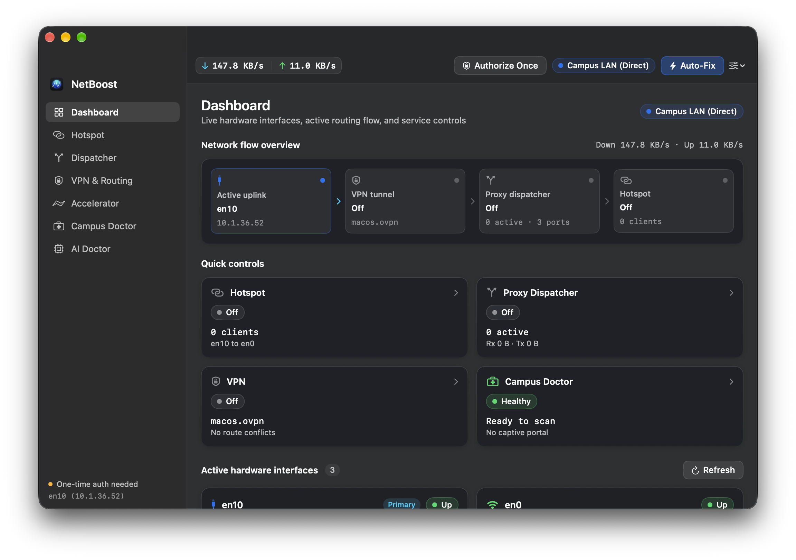
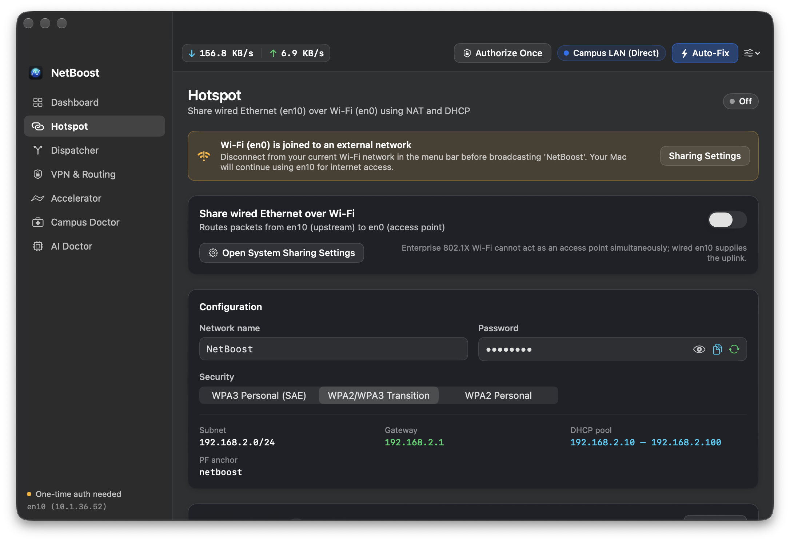
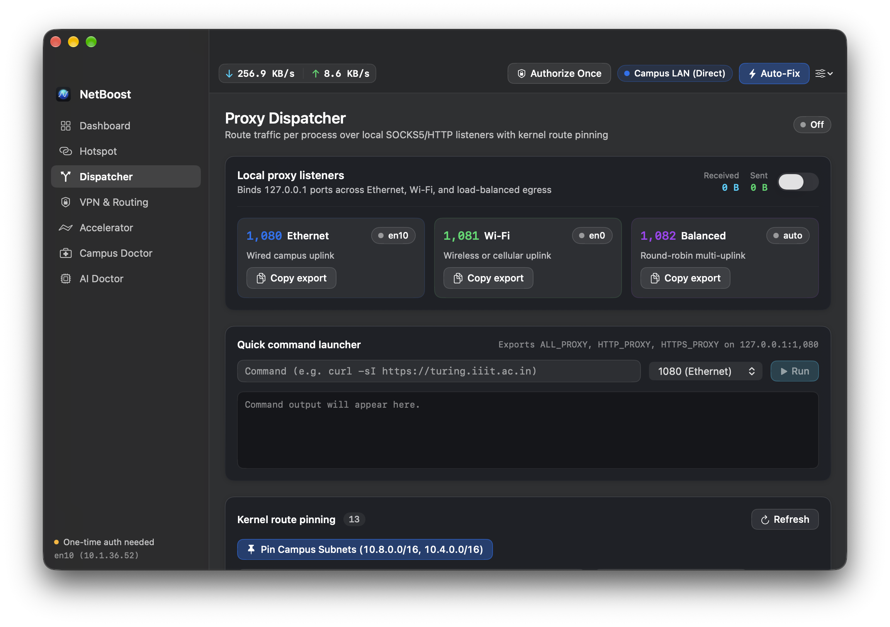
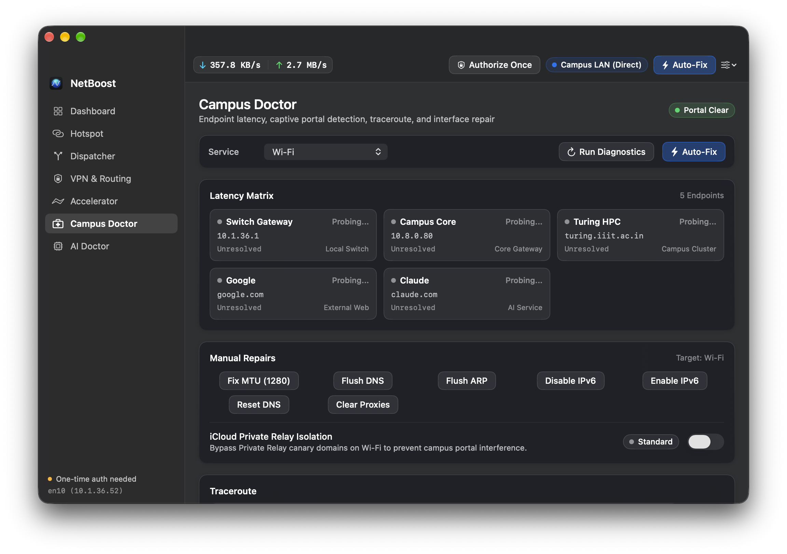

# NetBoost



NetBoost is a macOS network utility built with Swift 6 and SwiftUI. It shares 802.1X Ethernet over Wi-Fi and switches split-tunnel OpenVPN automatically. Built-in tools add per-interface proxies, chunked HTTP downloads, and local LAN repairs.

[](https://github.com/VA24d/NetBoost/actions/workflows/ci.yml)
[](https://creativecommons.org/licenses/by-nc-sa/4.0/)

## Screenshots

### Dashboard

The Dashboard shows active interfaces and live upload and download rates. Quick toggles control hotspot, proxy, and VPN automation.



### Hotspot sharing

Hotspot mode turns on kernel IP forwarding, loads the `netboost` PF anchor, writes WPA2 or WPA3 NAT settings, and lists client leases.



### Proxy dispatcher

The Proxy tab runs local SOCKS5 and HTTP CONNECT listeners on ports `1080` to `1082`, copies shell exports, and pins static subnets.



### Campus doctor

Campus Doctor probes gateway and external RTT, checks for captive portals, sets MTU `1280`, and resets DNS, ARP, and proxy state per service.



## Features

Seven tabs inside one window and a menu bar popover cover each network workflow.

### Ethernet-to-Wi-Fi sharing

Hotspot mode routes an 802.1X Ethernet uplink (`en10`) out over Wi-Fi (`en0`). NetBoost turns on `net.inet.ip.forwarding=1`, loads PF rules into the `netboost` anchor, and writes `com.apple.nat` settings with WPA2 or WPA3 security. Apple restricts third-party SoftAP radio startup on macOS. The UI pairs kernel setup with a button that opens Internet Sharing in System Settings. Client leases come from `/var/db/dhcpd_leases` and ARP scans.

### Proxy dispatcher and route pinning

`InterfaceProxyDispatcher` runs local SOCKS5 and HTTP CONNECT listeners on three ports on `127.0.0.1`. Port `1080` binds outbound sockets to `en10`, port `1081` binds to `en0`, and port `1082` alternates between both interfaces. Outbound sockets bind at the kernel level using `IP_BOUND_IF` and `IPV6_BOUND_IF`. In the Proxy tab, you can copy `ALL_PROXY` shell exports, run commands with proxy variables attached, or pin subnets like `10.8.0.0/16` to Ethernet.

### Context-aware VPN

`NetworkSensor` tracks interface changes using `NWPathMonitor` and `getifaddrs` metadata. On campus Ethernet (`10.1.x.x`), NetBoost drops split-tunnel profiles via `scutil --nc` so tunnel routes do not collide with the local gateway. After switching to cellular tethering or external Wi-Fi, it reconnects `macos.ovpn` or an imported `.ovpn` profile once subnet overlap checks pass.

### Multi-connection downloader

Single-stream HTTP transfers often hit per-connection rate caps. The downloader checks `Accept-Ranges: bytes`, opens 4 to 16 `URLSession.bytes` chunk workers, and writes segments into `~/Downloads` with locked `FileHandle` seeks. A clipboard watcher picks up copied URLs. `ChecksumValidator` checks SHA-256, SHA-1, or MD5 digests using `CryptoKit`.

### Campus doctor and local AI assistant

Campus Doctor sets MTU `1280` on the chosen service and flushes `dscacheutil` and `mDNSResponder`. Separate controls clear ARP entries, toggle IPv6, reset proxies, and isolate iCloud Private Relay per adapter. You can also run concurrent RTT probes and reorder network services. When LM Studio runs locally at `http://localhost:1234/v1`, the AI tab reads active models from `/v1/models`. It answers questions from telemetry snapshots and waits for your approval before running any suggested tool call.

## First-time privilege setup

PF NAT rules, MTU changes, static routes, and service priority edits need root access. On first use, NetBoost asks once for an admin password. That prompt installs `/Library/PrivilegedHelperTools/com.netboost.helper` and registers `/Library/LaunchDaemons/com.netboost.helper.plist`.

That LaunchDaemon listens on `/var/run/netboost/helper.sock`, checks the caller UID with `LOCAL_PEERCRED`, and validates each `HelperAction` before calling system binaries directly. Subsequent launches and repairs run without password prompts. You can uninstall the daemon anytime from the toolbar status popover.

## Repository layout

```text
NetBoost/
├── Assets/                       # AppIcon.png and Assets/screenshots/*.png
├── Package.swift                 # Swift 6.0 manifest (NetBoostCore, NetBoostApp, NetBoostHelper, NetBoostTests)
├── Makefile                      # Wraps build.sh, run_tests.sh, and swift package clean
├── vfs.yaml                      # Command Line Tools VFS overlay checked by build tooling tests
├── Scripts/
│   ├── build.sh                  # Builds targets via Xcode or CLT VFS fallback
│   ├── run_tests.sh              # Runs Swift Testing suites with CLT Testing.framework fallback
│   ├── package_dmg.sh            # Creates NetBoost.app, builds AppIcon.icns, signs, and packages .dmg
│   ├── netboost-helper.sh        # Legacy shell helper fallback bundled in app resources
│   └── *.modulemap / *.swiftoverlay
├── Sources/
│   ├── Core/                     # NetBoostCore library (no SwiftUI dependency)
│   │   ├── AIBridge/             # LM Studio client, telemetry JSON exporter, tool schemas
│   │   ├── Diagnostics/          # CampusDoctor, MTUManager, CaptivePortalDetector, LatencyProbe, RepairRoutines, ServiceOrderManager
│   │   ├── Downloader/           # RangeProbe, ChunkPartitionEngine, ChunkWorker, DiskAssembler, ClipboardWatcher, ChecksumValidator
│   │   ├── Hotspot/              # HotspotNATController, DHCPServer, DNSProxy, ARPScanner
│   │   ├── Models/               # Shared Codable/Sendable models for each subsystem
│   │   ├── NetworkEngine/        # InterfaceProxyDispatcher, SOCKS5Server, HTTPProxyServer, ProxySocketIO, RoutePinningEngine, ShellEnvGenerator
│   │   ├── System/               # PrivilegeHelper, HelperProtocol, DarwinSocketHelper, ShellCommand
│   │   └── VPN/                  # NetworkSensor, VPNRuleEngine, PassepartoutController, OpenVPNParser, RouteConflictDetector
│   ├── NetBoostApp/              # NetBoostApp SwiftUI desktop client and menu bar extra
│   │   ├── App/                  # NetBoostApp, AppState, AppStateTypes, and AppState+*.swift extensions
│   │   ├── Theme/                # GlassTheme color palette, window sizing, visual effects
│   │   └── Views/                # HeaderBarView, MainWindowView, MenuBarPopupView, and 7 feature tabs
│   └── NetBoostHelper/           # Root LaunchDaemon binary (Sources/NetBoostHelper/main.swift)
├── Tests/                        # Unit suites, Mocks/, Fixtures/, and Tier1-Tier5 E2ETests/
└── .github/workflows/            # CI (ci.yml), static checks (code-review.yml), and DMG release (release.yml)
```

## Build and install

Requirements are macOS 14 (Sonoma) or macOS 15 (Sequoia), plus Xcode 16+ or Apple Command Line Tools (`Swift 6.0+`). Download `NetBoost-1.0.0.dmg` from [Releases](https://github.com/VA24d/NetBoost/releases) and drag `NetBoost.app` into `/Applications`, or build from source:

```bash
git clone https://github.com/VA24d/NetBoost.git
cd NetBoost

./Scripts/build.sh
./Scripts/run_tests.sh
./Scripts/package_dmg.sh --version 1.0.0
```

Both `build.sh` and `run_tests.sh` detect whether Xcode or standalone Command Line Tools are active. Under Command Line Tools, they write `.build/vfs.generated.yaml` automatically before invoking `swift`.

## Future plans

Next updates will redraw `Assets/AppIcon.png` to merge the Ethernet and Wi-Fi shapes into one connected vector mark. Release builds will add Developer ID signing, notarization, and `SMAppService` support for Gatekeeper. Campus Doctor will gain broader live telemetry and extra diagnostic checks.

## License

Released under [CC BY-NC-SA 4.0](LICENSE) for non-commercial use with attribution and share-alike distribution.
