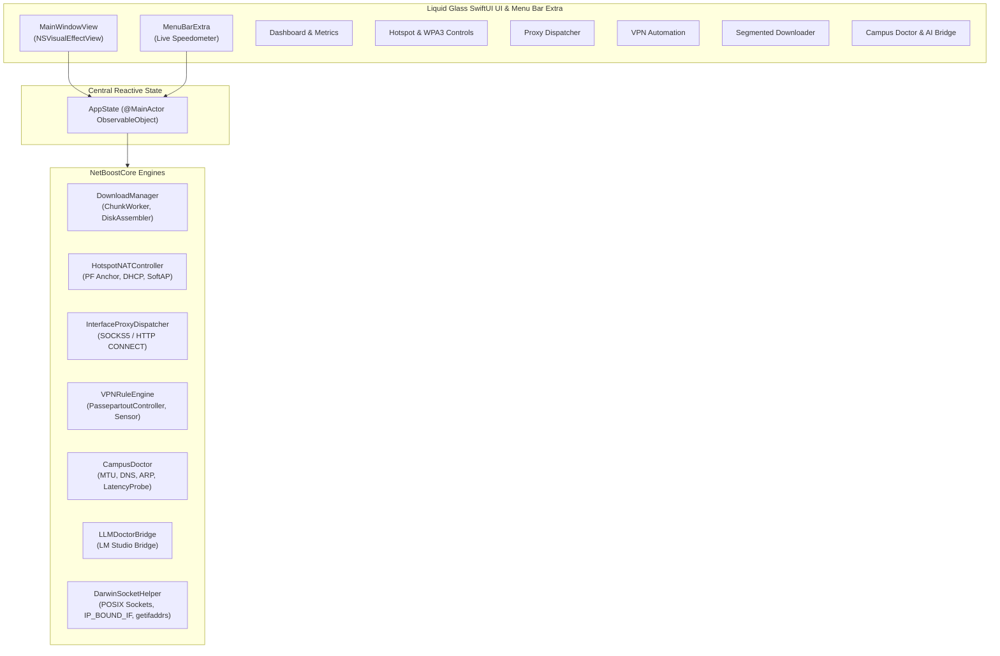

# NetBoost 🚀

> **High-Performance macOS Network Controller, Multi-Connection Download Accelerator & Campus Doctor**  
> Built natively in Swift 6.2 with Liquid Glass UI for macOS Sequoia and Sonoma.

[](https://github.com/VA24d/NetBoost/actions/workflows/ci.yml)
[](https://creativecommons.org/licenses/by-nc-sa/4.0/)
[%20%7C%2015%20(Sequoia)-blue.svg)]()
[-brightgreen.svg)]()
[]()

---

> [!IMPORTANT]
> **Active Testing Notice**: NetBoost is currently in **Active Testing / Beta**. Core engines, Packet Filter NAT anchors, and network dispatchers are actively undergoing hardening and real-world campus network validation (`10.1.36.0/22`). Features are subject to refinement based on test feedback.

---

## 🌟 Key Features

### 1. ⚡ Segmented Download Accelerator
- **Multi-Part Concurrency**: Dynamic chunk partition engine splitting HTTP/HTTPS downloads into 8–16 simultaneous parallel byte streams (`Range: bytes=X-Y`).
- **Random-Access Disk Assembler**: POSIX `pwrite` disk writing with file pre-allocation (`fstore_t`), eliminating fragmentation and lock contention.
- **Dynamic Worker Pool & Resumption**: Auto-recovery from socket drops, exponential backoff, and state checkpointing.
- **Integrity Validation**: Streaming SHA-256 / MD5 hardware checksum verification with visual pass/fail badges.
- **Clipboard Sentinel**: Real-time URL pasteboard watcher automatically capturing download links.

### 2. 📡 802.1X Wired-to-Wireless Hotspot Engine
- **Campus LAN Sharing**: Share authenticated 802.1X Wired Ethernet (`en10`) over Wi-Fi (`en0` / `ap1`) with Packet Filter (PF) NAT.
- **Isolated Kernel Anchor**: Rules loaded exclusively into `anchor "netboost"`—zero pollution of global macOS firewall state.
- **WPA3 Personal Support**: Full support for **WPA3 Personal (SAE)**, **WPA2/WPA3 Transition Mode**, and **WPA2 Personal**.
- **Password Controls**: View/hide password toggle, one-click clipboard copy, and built-in cryptographically strong password generator.
- **Embedded DHCP & ARP Scanner**: Real-time lease tracking, active client resolution, and per-device throughput accounting.
- **iCloud Private Relay Compatibility**: Interface-scoped packet filter rules ensure other adapters (cellular / external Wi-Fi) retain full iCloud Private Relay functionality.

### 3. 🔀 Interface Proxy Dispatcher & Kernel Route Pinning
- **Multi-Port Egress Listener**:
  - `127.0.0.1:1080` → Pinned to Wired Campus Ethernet (`en10`)
  - `127.0.0.1:1081` → Pinned to Wi-Fi / External Uplink (`en0`)
  - `127.0.0.1:1082` → Auto Low-Latency Dispatcher
- **Darwin POSIX Binding**: Sets `IP_BOUND_IF` / `SO_BINDTODEVICE` at the kernel socket layer.
- **Dual Protocol**: Both SOCKS5 (RFC 1928) and HTTP CONNECT proxying on all ports.
- **One-Click Shell Export**: Generates and copies ready-to-use terminal environment snippets (`export ALL_PROXY=socks5://127.0.0.1:1080`).

### 4. 🛡️ Context-Aware VPN Automation
- **Autonomous Sensor**: Monitors default gateway and BSSID changes. Automatically engages campus VPN profiles on untrusted networks and disconnects on direct LAN.
- **Passepartout & `macos.vpn` Bridge**: Native CLI automation (`/usr/local/bin/macos.vpn`).
- **Route Conflict Detector**: Scans routing tables for CIDR collisions (e.g. `10.1.0.0/16` vs campus subnets) before connection.

### 5. 🩺 Campus Network Doctor & Diagnostics
- **One-Click Auto-Fix**: Atomic execution of network repairs:
  - Sets interface MTU to 1280 (resolves cellular hotspot / Jio / iPhone TLS `bad record mac` and packet drops).
  - Flushes `mDNSResponder` and `dscacheutil` DNS caches.
  - Clears kernel ARP cache.
- **Target Endpoint Probing**: Concurrent ICMP/TCP latency measurements against target endpoints (`turing.iiit.ac.in`, `google.com`, `claude.com`, gateway `10.1.36.1`, core `10.8.0.80`).
- **Captive Portal Detection**: HTTP probe tracking redirection traps and 204 response codes.

### 6. 🤖 Local AI Doctor Bridge (LM Studio)
- **Local LLM Integration**: Connects to local OpenAI-compatible models running via LM Studio at `http://localhost:1234/v1`.
- **System Telemetry Export**: Packages latency traces, MTU configurations, and routing tables into structured JSON context.
- **Human-in-the-Loop Tool Execution**: AI proposes repair tools (e.g. `fix_mtu`, `flush_dns`, `cycle_interface`) requiring explicit user approval before execution.

### 7. 💎 Liquid Glass SwiftUI Interface
- **Vibrant Desktop Translucency**: Native AppKit `NSVisualEffectView` behind-window liquid glass blur.
- **Cmd + Tab & Dock Integration**: Registered as a regular macOS application with full App Switcher presence.
- **Live Hardware Throughput**: Real-time download/upload speedometers reading Darwin kernel byte counters (`if_data`).
- **Customization Options**: Multiple styles for status bar (`Icon + Speed`, `Compact Speed`, `Minimal Badge`) and app logo (`Sapphire Bolt`, `Liquid Waveform`, `Network Core`).

---

## 🏗️ Architecture



---

## 📦 Installation & Releases

### Pre-Built DMG Release
Download the latest disk image from the [Releases](https://github.com/VA24d/NetBoost/releases) page:
1. Download `NetBoost-1.0.0.dmg`.
2. Open the DMG and drag **NetBoost** into your `/Applications` folder.
3. Launch NetBoost from Applications or Spotlight.

### Building from Source

**Prerequisites:**
- macOS Sonoma (14.0+) or macOS Sequoia (15.0+)
- Apple Silicon Mac (M1/M2/M3/M4)
- Xcode 16+ or Command Line Tools (Swift 6.2)

```bash
# Clone the repository
git clone https://github.com/VA24d/NetBoost.git
cd NetBoost

# Build debug executable
./Scripts/build.sh

# Run comprehensive test suite
./Scripts/run_tests.sh

# Package standalone .app bundle and .dmg installer
./Scripts/package_dmg.sh
```

---

## 🗺️ Future Roadmap

- [x] **v1.0 (Current)**:
  - [x] Multi-Connection Segmented Download Accelerator (8–16 chunks).
  - [x] SOCKS5/HTTP Proxy Dispatcher with kernel route pinning (`IP_BOUND_IF`).
  - [x] 802.1X Wired-to-Wireless Hotspot sharing with WPA3 & isolated PF NAT.
  - [x] Campus Doctor diagnostic suite (MTU 1280 auto-fix, DNS, ARP).
  - [x] Local LM Studio AI Doctor bridge.
  - [x] Liquid Glass SwiftUI UI with Menu Bar Extra.
- [ ] **v1.1 (Upcoming)**:
  - [ ] Extended Wi-Fi 6E (6GHz) SoftAP beaconing support.
  - [ ] Automatic fallback to secondary network interfaces on gateway packet loss.
  - [ ] Direct WireGuard / IPSec user-space tunnel engine.
  - [ ] Scheduled background diagnostic health reporting.
- [ ] **v1.2 (Long-term)**:
  - [ ] Multi-path TCP (MPTCP) aggregation across simultaneous Wi-Fi and Ethernet.
  - [ ] Native Swift-embedded local inference engine (MLX / CoreML).
  - [ ] Dynamic bandwidth throttling and QoS per connected hotspot client.

---

## 📜 License & Usage Terms

NetBoost is licensed under the **Creative Commons Attribution-NonCommercial-ShareAlike 4.0 International Public License (CC BY-NC-SA 4.0)**.

- **Attribution Required**: You must give appropriate credit, provide a link to the license, and indicate if changes were made.
- **Non-Commercial Only**: You may not use this material for commercial purposes or monetization.
- **ShareAlike (Copyleft)**: If you remix, transform, or build upon the material, you must distribute your contributions under the same license (CC BY-NC-SA 4.0). Downstream recipients cannot alter or restrict these rights.

See [LICENSE](LICENSE) for the complete legal text.

---

**Developed with ❤️ for Academic & Campus Networks**
